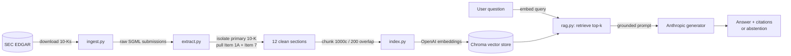

# SEC RAG Eval

**A retrieval-augmented question-answering system over SEC 10-K filings, built as the test subject for a from-scratch LLM evaluation harness.**

The interesting part of this project is not the RAG pipeline — those are everywhere. It's the **CI/CD-style evaluation harness** being built on top of it: a test suite that runs a curated question set against the RAG system on every prompt / model / index change, scores faithfulness and abstention with an independent judge model, blocks regressions, and tracks cost per run. Testing LLM systems rigorously is a rarer skill than building them, so that's where this project puts its weight.

This repo is built in public, week by week. The sections below are explicit about **what runs today** versus **what is designed and on the roadmap** — no vaporware.

---

## Status at a glance

| Component | State |
|---|---|
| RAG pipeline (ingest → extract → chunk → embed → retrieve → generate) | ✅ **Working end-to-end** |
| Corpus: 3 companies × 2 years × 2 sections, 1,464 indexed chunks | ✅ Built |
| Grounded generation with inline citations + abstention | ✅ Working |
| Heuristic section extraction hardened against real-filing quirks | ✅ Working |
| Golden evaluation dataset (~120 tiered Q&A pairs) | 📋 Designed, not yet built |
| Evaluation harness (judge model, faithfulness/abstention metrics, cost caps) | 📋 Designed, not yet built |
| GitHub Actions CI (PR comments, merge blocking) | 📋 Roadmap |

---

## Why 10-K filings

SEC annual reports are a serious, public, information-dense corpus that enterprise hiring managers take seriously. The project deliberately uses only the **prose** sections — Item 1A (Risk Factors) and Item 7 (Management's Discussion & Analysis) — and skips financial tables and XBRL, which are a much harder, separate problem. The corpus is small enough that infrastructure never becomes the project, but its cross-company / cross-year structure makes multi-document synthesis and comparison questions possible — which is exactly where most RAG systems fall over, and therefore a strong evaluation angle.

**Corpus today:** Microsoft, Alphabet (Google), and Meta — 10-Ks filed in 2023 and 2024 — Item 1A + Item 7 from each → 12 sections → 1,464 chunks.

---

## Architecture



### The three-family model stack

A deliberate choice for **evaluation rigor**: each stage of the system uses a model from a different provider family.

| Stage | Provider | Model | Why this one |
|---|---|---|---|
| Embeddings | OpenAI | `text-embedding-3-small` | Cheap, strong retrieval quality |
| Generator | Anthropic | `claude-haiku-4-5` | Fast and cheap — and intentionally *more* hallucination-prone than larger models, which makes the eval harness visibly useful |
| Judge *(Week 3+)* | Google | `gemini-2.0-flash` (free tier) | **Different family from the generator** — an LLM judge scores same-family outputs more favorably, so a cross-family judge structurally reduces bias instead of relying on prompt tricks. Free tier keeps the project affordable; falls back to Claude Haiku when rate-limited. |

This is the core eval-methodology story: the thing scoring the answers should not share a family with the thing producing them.

---

## What it looks like

A normal in-corpus question — answered, grounded, with inline `[TICKER YEAR §section]` citations:

```
$ python -m scripts.ask "How did Microsoft describe its cloud business performance?"

Microsoft described its cloud business performance with strong growth metrics.
Microsoft Cloud revenue increased 22% to $111.6 billion in fiscal 2023
[MSFT 2023 §mdna] and further increased 23% to $137.4 billion in fiscal 2024
[MSFT 2024 §mdna].
```

An out-of-corpus question — the system **abstains** instead of bluffing:

```
$ python -m scripts.ask "What is Apple's strategy for the automotive market?"

I don't have enough information in the provided filings to answer this question.
```

Abstention is a first-class behavior here, not an afterthought. Most RAG demos confidently make something up when retrieval fails; refusing to is a key differentiator and one of the four tiers the evaluation dataset is built to test.

Inspect retrieval directly with `--show-chunks`:

```
$ python -m scripts.ask --show-chunks "How did Microsoft describe its cloud business performance?"

--- Retrieved chunks ---
[1] MSFT FY2023 §mdna (chunk #..., score=0.670)  ... Microsoft Cloud revenue ...
[2] MSFT FY2024 §mdna (chunk #..., score=0.670)  ... remaining performance obligations ...
...
```

---

## Quick start

Requires Python 3.10+, plus API keys for OpenAI and Anthropic. (A Gemini key is only needed for the evaluation harness in Week 3+ — free to obtain at <https://aistudio.google.com/apikey>.)

```bash
# 1. Environment
python -m venv .venv
source .venv/bin/activate          # Windows PowerShell: .venv\Scripts\Activate.ps1
pip install -r requirements.txt

# 2. Secrets
cp .env.example .env               # then edit .env (see below)

# 3. Build the index — downloads filings, extracts sections, embeds into Chroma
python -m scripts.build_index

# 4. Ask questions
python -m scripts.ask "What risks did Meta disclose about AI competition?"
python -m scripts.ask --show-chunks "How did Microsoft describe its cloud business?"
```

`.env` needs:

```ini
OPENAI_API_KEY=sk-...                          # embeddings
ANTHROPIC_API_KEY=sk-ant-...                   # generation (+ fallback judge later)
GEMINI_API_KEY=...                             # judge, Week 3+ only (free tier)
SEC_EDGAR_USER_AGENT="Your Name you@email.com" # required by EDGAR's terms of service
```

> **Note:** the OpenAI and Anthropic **API** keys are pay-as-you-go and are *not* the same as a ChatGPT Plus / Claude.ai subscription. A full Week-1 index build costs roughly **$0.02** in embeddings.

---

## Project layout

```
src/
  config.py     # single source of truth: models, prompts, chunking, cost caps
  ingest.py     # download 10-Ks from SEC EDGAR
  extract.py    # isolate the primary 10-K and pull Item 1A + Item 7
  index.py      # chunk → embed (OpenAI) → persist (Chroma)
  rag.py        # retrieve top-k → generate grounded answer
scripts/
  build_index.py  # one-shot: ingest → extract → index
  ask.py          # CLI to query the pipeline (--top-k, --show-chunks)
data/             # gitignored: raw filings, extracted sections, Chroma store
```

Everything tunable — prompts, model names, `CHUNK_SIZE`, `CHUNK_OVERLAP`, `TOP_K`, cost ceilings — lives in **`src/config.py`** and nowhere else. This is a requirement, not a style preference: the evaluation harness will sweep these as single-variable changes ("does `TOP_K=8` beat `TOP_K=5`?") and rerun the suite, so they must be addressable from one place and diffable in version control.

---

## Design decisions

These are deliberate; each trades something away on purpose.

- **Built from scratch — no LangChain / LlamaIndex.** When the eval harness flags a regression, you want to know exactly which line caused it. Frameworks abstract that away. "Built a custom eval harness" is also a stronger signal than "configured Ragas."
- **Prose sections only — no tables / XBRL.** Table extraction from 10-Ks is a hard, separate problem; including it would make the project about parsing, not evaluation.
- **A cheap, hallucination-prone generator on purpose.** Claude Haiku is the Week-1 generator precisely *because* it errs more than a frontier model — that makes the eval harness demonstrably useful. Upgrading to Sonnet later becomes an experiment the harness can score, not a guess.
- **Heuristic, debuggable extraction.** Sections are found by locating real `Item N.` headers and taking the longest span to the next item. Simple and inspectable, hardened only where real filings broke it (see below).
- **Abstention is first-class.** The generator is instructed to emit one exact sentence when the context can't support an answer, detected downstream as a structured flag.
- **Cost discipline is an architectural constraint, not a nice-to-have.** See below.

---

## Engineering deep-dive: making extraction survive real filings

The first end-to-end run "worked" but produced quietly broken data. Diagnosing it is a good illustration of how messy real-world inputs are — and it's the kind of thing the evaluation harness exists to catch automatically.

**Symptom.** Microsoft's MD&A section extracted as 4,648 characters — a single page of a section that should be tens of thousands of characters. Queries about Microsoft's cloud business abstained, because the retriever only had a fragment of table noise to work with.

Three stacked bugs, peeled back one at a time:

1. **Wrong document entirely.** The EDGAR downloader saves `full-submission.txt`: the *entire* SGML submission — the 10-K plus every exhibit plus inline XBRL — ~30 MB, ~10.5 million characters once flattened. Parsing all of it made the 10-K's `Item N` headers indistinguishable from the same strings in exhibits and financial data. **Fix:** isolate the first `<DOCUMENT>` block of type `10-K` and parse only its body. 10.5M chars → ~440K.

2. **Running page headers shredded the heuristic.** Even in the clean 10-K, Microsoft stamps a running `Item 7` header at the top of *every page* of the MD&A, and the body is full of cross-references ("see Item 8…", "Item 7 of this Form 10-K…"). That's ~20 spurious `Item 7` matches per section, so "longest span between item headers" only ever captured a single page. **Fix:** require a trailing period or colon (`Item 7.`), which real section headers have and running headers / cross-references do not. Spurious matches per filing dropped from ~180 to ~47.

3. **A silent metadata bug was halving the corpus.** The fiscal-year was parsed from the cover page, but the search window was 8,000 characters and the cover-page statement sits ~35,000 characters in (past the SGML preamble) — so it missed 100% of the time. Because the output filename embedded the year (`MSFT_None_mdna.json`), *both* years of each filing collided onto the same filename and silently overwrote each other — **12 sections were quietly becoming 6**. **Fix:** widen the search window; correct years restore distinct filenames.

**Result:** 2 of 6 sections extracting cleanly → **12 of 12**; 377 indexed chunks → **1,464**; Microsoft's MD&A 4,648 chars → 55,536 chars; and the cloud-performance question went from abstaining-on-noise to the correct, fully-cited answer shown above.

One failure mode was left **deliberately unfixed**: a question like *"What did Meta disclose about AI competition?"* now retrieves Microsoft's and Google's AI-risk passages instead of Meta's, because the retriever ranks purely on semantic similarity with no company filter, and all three companies use similar AI-risk language. The content *is* in the index — it's a retrieval-recall problem, not missing data. That is precisely the kind of issue the evaluation harness is meant to **measure** rather than paper over with an ad-hoc threshold, so it stays on the books as a tracked finding.

---

## Cost discipline

The whole project runs on a **~$15 total budget** — a real constraint, treated as an architectural one. The practices that make that realistic are also legitimate engineering ("cost observability built into the eval harness from day one"):

- **Subset-first iteration** — default eval runs hit a 20-question stratified subset; the full ~120 only on confirm / baseline / CI.
- **Cache everything cacheable** — deterministic (temperature-0) calls are keyed and cached, so re-running an unchanged suite costs $0.
- **Hard cost cap per run** — runs estimate token spend up front and abort if it exceeds the cap.
- **Free-tier-aware judge with paid fallback** — Gemini free tier for routine eval, automatic fallback to paid Claude Haiku when rate-limited.
- **Per-run spend tracking** — every run prints its cost and cumulative project spend, so there are no surprises.

Spend so far (Week 1, fully built and tested): **~$0.04**.

---

## Roadmap

| Week | Goal | Status |
|------|------|--------|
| 1 | Minimal RAG end-to-end over 3 companies × 2 years | ✅ Done |
| 2 | Build the ~120-question golden dataset (4 tiers: factual, synthesis, cross-document, adversarial/abstention) | 📋 Designed |
| 3–4 | Build the eval harness — judge prompts, faithfulness + abstention metrics, cost caps, run deltas | 📋 Next |
| 5 | GitHub Actions CI — PR comments, merge blocking on regressions, full corpus | 📋 |
| 6 | Methodology write-up | 📋 |

The golden dataset's four tiers — single-document factual, single-document synthesis, cross-document comparison, and adversarial/out-of-corpus (where the correct answer is abstention) — are what turn "the RAG seems to work" into a measurable, regression-tested claim.

---

## Tech stack

Python · [ChromaDB](https://www.trychroma.com/) (persistent vector store) · OpenAI embeddings · Anthropic generation · Google Gemini judge (Week 3+) · BeautifulSoup + lxml for filing extraction · `sec-edgar-downloader` for ingest. No RAG framework.
